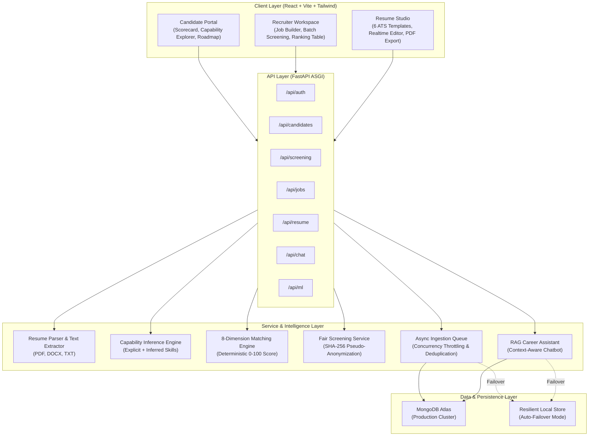

# System Architecture & Technical Specifications

## 1. High-Level System Architecture

---

## 2. 8-Dimension Job Matching Breakdown

Every candidate is evaluated across an 8-dimensional weighted scoring framework:

| Dimension | Default Weight | Description |
| :--- | :--- | :--- |
| **Required Technical Skills** | 25% | Direct keyword & synonym presence |
| **Experience Fit** | 20% | Total years vs. seniority benchmark |
| **Project & Evidence Impact** | 15% | Metrics, quantifiers, action verbs |
| **Preferred Skills** | 10% | Secondary & bonus competencies |
| **Education & Certifications** | 10% | Degree level and accredited credentials |
| **Tooling & Cloud Ecosystem** | 10% | DevOps, databases, and infra familiarity |
| **Domain Experience** | 5% | Industry context and relevant tenure |
| **Role Stability & Growth** | 5% | Progression trajectory and career momentum |

---

## 3. Resilience & Zero-Downtime Design

The platform uses dual-mode database failover:
1. **Primary**: Asynchronous connection to MongoDB Atlas with non-blocking connection pool.
2. **Fallback**: If network connectivity is interrupted, the system automatically writes to and reads from local transactional storage (`local_db.json`) without throwing 500 errors to end users.

